# StudyBuddy

아기자기한 스터디 관리 앱 **UI 프로토타입**입니다.  
**Android 전용** (iOS 미지원). React Native(Expo) + Expo Router + Kotlin 네이티브 모듈(데모)을 씁니다.

서버 없이 **AsyncStorage + 더미 데이터**로 동작합니다.  
데모 스위치: `src/config/demo.ts`의 `DEMO_MODE`.

<p align="center">
  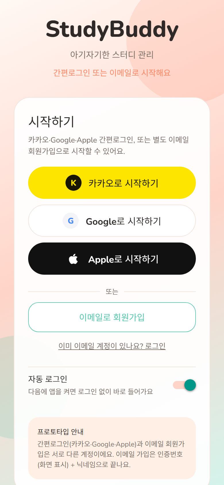
  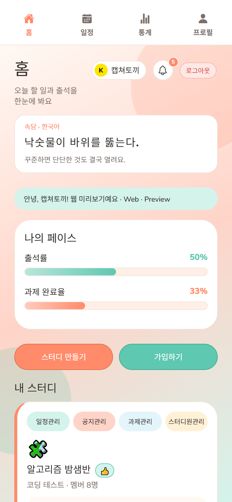
  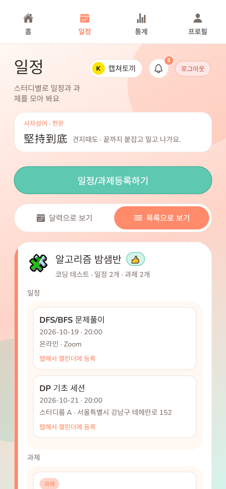
</p>

---

## 플로우

```
회원가입 / 로그인
  → 스터디 만들기 · 가입
  → 스터디 홈 (출석 · 과제 · 공지 · 멤버)
  → 일정 · 통계 · 프로필 · 알림
```

---

## 상단 탭

| 탭 | 역할 |
|----|------|
| **홈** | 닉네임 · 사자성어 · 알림 종 · 로그아웃 · 다가오는 일정 · 빠른 출석 · 내 스터디 |
| **일정** | 달력/목록 · 일정·과제 등록(스터디장) · 캘린더 내보내기 |
| **통계** | 출석률 · 과제 완료율 · 연속 출석 |
| **프로필** | 닉네임 · 이메일 인증 · 계정 연결 · 회원 탈퇴 |

출석·과제·공지·멤버 관리는 **스터디 홈** (`studies/[studyId]`) 안에서 봅니다.

### 헤더 공통

- **닉네임** 탭 → 프로필
- **종 아이콘** → 최근 10개 알림 미리보기 → 항목 탭 시 관련 화면 · **더보기**로 알림함
- **로그아웃**

---

## 주요 기능

### 로그인

간편로그인(**카카오 · Google**) 또는 이메일 회원가입으로 시작합니다. (Apple 미지원)


### 홈

내 페이스(출석·과제), 스터디 만들기/가입, 스터디장 관리 버튼이 한눈에 보여요.


### 스터디

공개/비공개 만들기 · 검색 · 초대코드 가입. 이미 가입한 스터디는 가입 목록에서 숨깁니다.

| 스터디 홈 | 스터디 가입 |
|-----------|-------------|
| 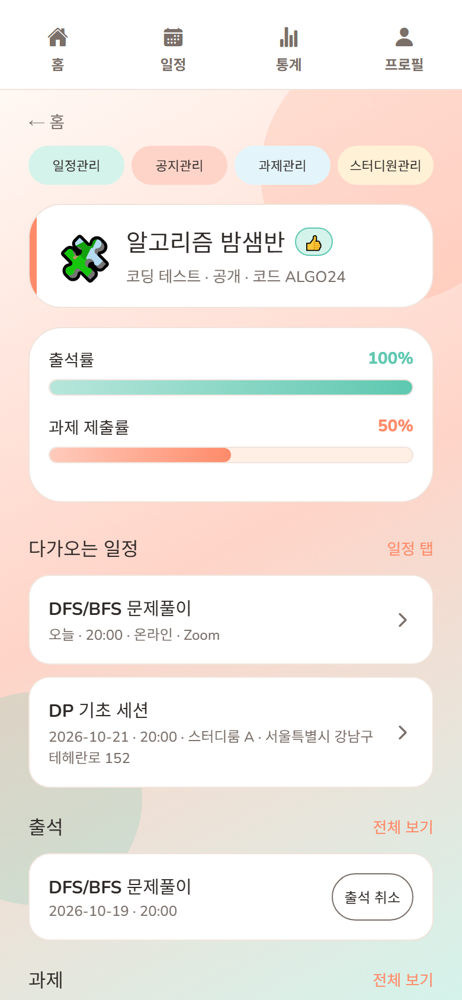 | 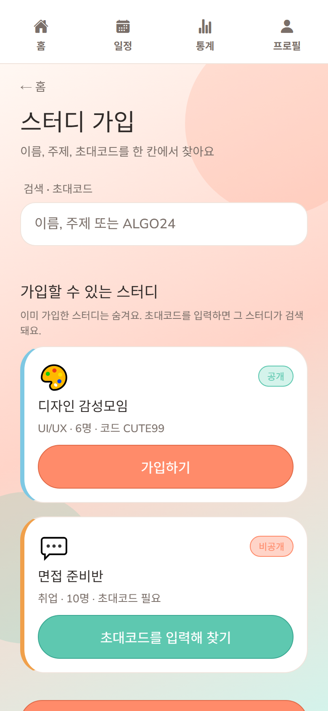 |

- **스터디장(👍)**: 일정·과제·공지 등록/수정/삭제, 스터디원 관리, 스터디 삭제
- **스터디장 위임**: 요청 → 상대 수락 후 이전
- 멤버별 출석·과제 현황 (스터디장)

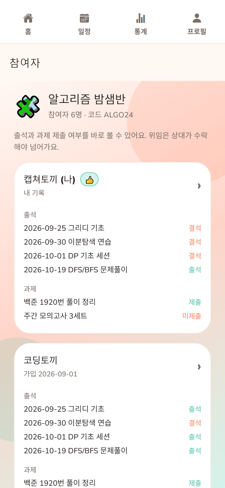

### 일정 · 과제

- 일정: 온라인/오프라인, 오프라인 시 주소 검색
- 과제: **파일 제출**(이미지·워드·엑셀·PDF, 10MB) 또는 **메모**(최대 1000자)
- 달력에 일정·과제 마감일 함께 표시
- 달력: **토=파란**, **일·공휴일·국경일=붉은** 날짜 · 한국 공휴일/국경일 이름 표기
- 일정 탭 → **기기/Google 캘린더**에 등록


### 알림함

종을 누르면 최근 10개 미리보기, **더보기**로 알림함으로 이동합니다.

| 미리보기 | 알림함 |
|----------|--------|
| 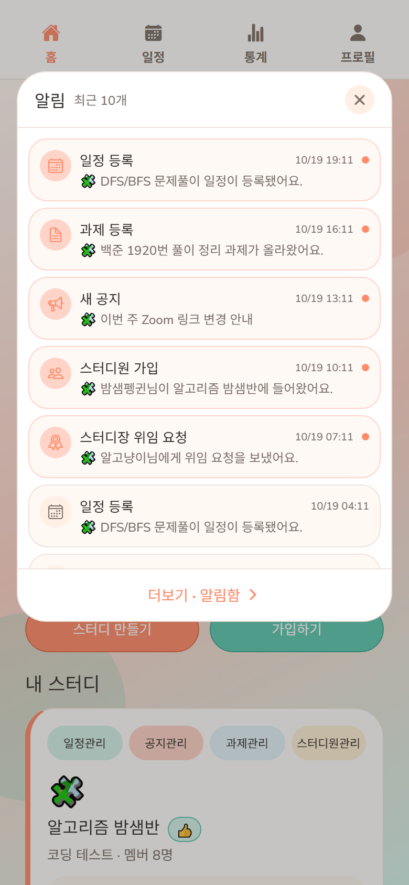 | 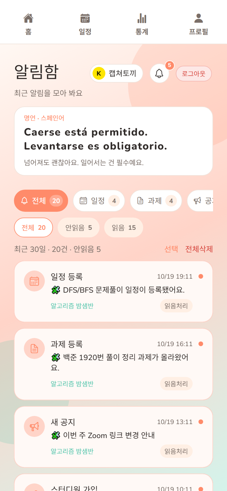 |

| 종류 | 예시 |
|------|------|
| 일정 | 등록 · 수정 · 삭제 |
| 과제 | 등록 · 수정 · 삭제 |
| 공지 | 등록 · 수정 · 삭제 |
| 멤버 | 가입 · 탈퇴 |
| 위임 | 스터디장 위임 요청 · 수락 |

- 종 뱃지: 안읽음 수 (`99+`까지)
- 종류·읽음 필터, 스와이프/선택 삭제, 읽음처리 · 안읽음 처리
- 알림 탭 → 일정 / 과제 / 스터디 홈 / 멤버 화면으로 이동
- **30일**이 지난 알림은 자동 삭제

### 통계

출석률 · 과제 완료율 · 연속 출석을 확인해요.

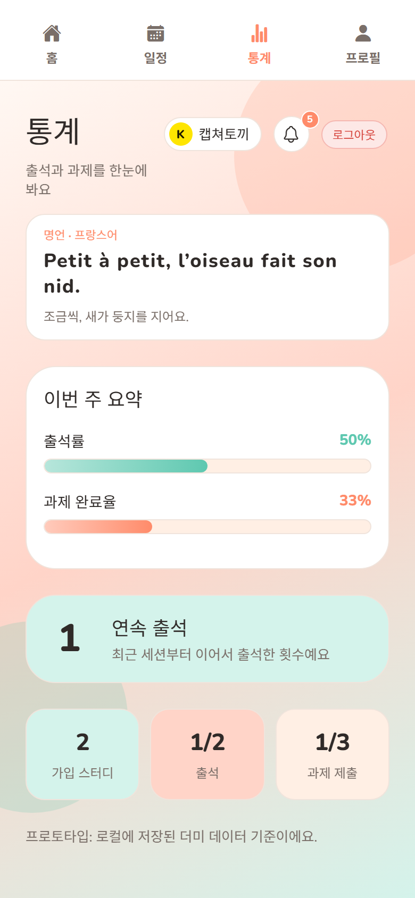

### 프로필

닉네임 · 이메일 인증 · 계정 연결 · **앱 색상(테마 3종)** · **회원 탈퇴**.

| 테마 | 팔레트 |
|------|--------|
| 피치 민트 | 처음 쓰던 피치·민트 |
| 네이비 크림 | `#010736` · `#0D1C42` · `#22396F` · `#FCF1D0` |
| 세이지 라벤더 | `#F6E2E9` · `#FEFAF3` · `#B8CFB3` · `#84A282` |

| 기본 정보 | 계정 연결 · 탈퇴 |
|-----------|------------------|
| 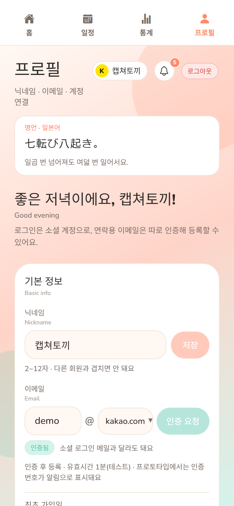 | 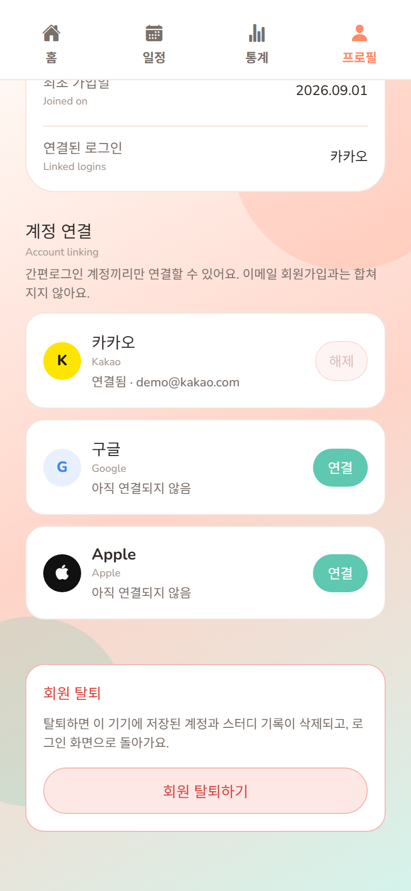 |

---

## 실행 (Android)

### 준비물

- Node.js 18+
- Android Studio (SDK, 에뮬레이터 또는 실기기)
- JDK 17

### 명령어

```bash
cd study-app
npm install

# Android 네이티브 프로젝트 생성 (Kotlin 포함)
npx expo prebuild --platform android

# 에뮬레이터/기기에서 실행
npx expo run:android
```

JS만 수정할 때:

```bash
npx expo start
```

유용한 명령:

```bash
npx expo lint
npx tsc --noEmit
npx expo-doctor
```

### README 스크린샷 다시 찍기

Expo web이 `http://localhost:8081`에서 떠 있는 상태에서:

```bash
npx expo start   # 다른 터미널에서 web 선택 또는 브라우저로 접속
node scripts/capture-screenshots.mjs
```

결과는 `docs/screenshots/`에 저장됩니다.

---

## React + Kotlin 연동 (데모)

로컬 모듈: `modules/device-greeting/` — **프로토타입용 인사 칩**만 담당합니다. 실서비스에선 제거·교체해도 됩니다.

| 구분 | 경로 |
|------|------|
| Kotlin | `modules/device-greeting/android/.../DeviceGreetingModule.kt` |
| JS | 홈 화면에서 `getGreeting()` / `getPlatformLabel()` 표시 |

네이티브 코드를 바꾼 뒤에는 `npx expo run:android`로 다시 빌드하세요.

---

## 캘린더에 일정 등록

일정 목록/달력에서 일정을 탭하면 **기기 캘린더** 또는 **Google 캘린더**에 등록할 수 있습니다.

- **기기 캘린더:** `expo-calendar` (개발 빌드 권장, Expo Go에서는 제한될 수 있음)
- **Google 캘린더:** 브라우저/앱 작성 화면 오픈

```bash
npx expo prebuild --platform android
npx expo run:android
```

---

## 네이버 지도 주소 검색 (선택)

일정 등록에서 **오프라인**을 고르면 네이버 지도/검색으로 주소를 붙일 수 있습니다.

1. `.env.example`을 참고해 프로젝트 루트에 `.env` 작성
2. [네이버 클라우드 Maps Geocoding](https://www.ncloud.com/product/applicationService/maps) 또는 [네이버 지역 검색 API](https://developers.naver.com/docs/serviceapi/search/local/local.md) 키 발급
3. `npx expo start` 재시작

키가 없으면 데모 검색 결과로 동작합니다.  
**웹**에서는 CORS 때문에 실제 API 대신 데모로 떨어질 수 있습니다. (타깃 플랫폼은 Android)

---

## 더미 초대코드

| 코드 | 스터디 |
|------|--------|
| `ALGO24` | 알고리즘 밤샘반 |
| `TOEIC7` | 토익 아침 스터디 |
| `CUTE99` | 디자인 감성모임 |
| `JOB202` | 면접 준비반 |

---

## 로그인 / 회원가입 (프로토타입)

| 방식 | 흐름 |
|------|------|
| **간편로그인** | 카카오 / Google → (신규면) 닉네임 → 스터디 가입 |
| **이메일 가입** | 인증번호(화면에 표시) → 닉네임 → 완료 |

- 목(mock) 로그인입니다. 실연동 시 `src/auth/social.ts`의 `mockSocialSignIn`을 바꾸면 됩니다.
- **Apple 로그인은 지원하지 않습니다** (Android 전용).
- 소셜끼리 이메일이 같으면 계정이 연결될 수 있어요.
- **이메일 가입**은 간편로그인과 **별도 계정**입니다.
- 이메일·닉네임은 유니크하며, 중복이면 안내합니다.

---

## 프로젝트 구조 (요약)

```
app/                 # Expo Router 화면
  (auth)/            # 로그인 · 회원가입 · 닉네임
  (tabs)/            # 홈 · 일정 · 통계 · 프로필 · 스터디 · 알림함
src/
  components/        # UI 공통 (EmptyState, SoftBackground …)
  config/demo.ts     # DEMO_MODE · 데모 초대코드
  data/              # 더미 · 알림 시드
  store/             # AppContext (AsyncStorage)
  auth/              # 소셜/이메일 mock (카카오·Google)
  theme/             # 팔레트 · useThemedStyles
docs/screenshots/    # README용 화면 캡처
scripts/
  capture-screenshots.mjs
modules/
  device-greeting/   # Kotlin 네이티브 모듈 (데모)
```

데이터 키: `studybuddy.v4` (AsyncStorage)
